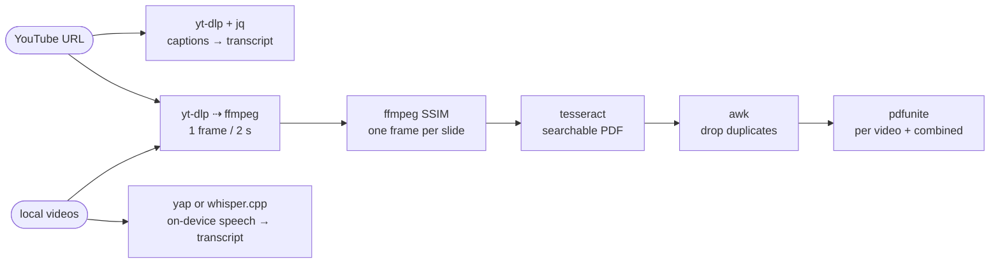

# minVid2slides

[](https://github.com/jcxk/minVid2slides/actions/workflows/test.yml)
[](https://github.com/jcxk/minVid2slides/releases)
[](LICENSE)


YouTube talks, playlists or local videos → searchable slide PDFs + timestamped transcripts. One bash script, macOS and Linux.

| | |
|---|---|
| **Category** | Original-slide recovery: keeps the real frames shown in the video, generates nothing |
| **Input** | YouTube videos and playlists (or any [yt-dlp site](https://github.com/yt-dlp/yt-dlp/blob/master/supportedsites.md)), local video files |
| **Output** | One PDF per video plus a combined PDF, and a timestamped transcript `.txt` |
| **Processing** | Local. URLs are streamed from the site; frames, OCR and local transcripts run on your machine |
| **Editability** | Slide images with an OCR text layer (searchable, copyable); not native PPTX objects |
| **Platforms** | macOS 27 and Ubuntu 26.10 (tested); Windows via WSL not tested |
| **License** | MIT |



## Performance

No Python runtime and no ML framework. The work is done by long-proven CLI tools (`ffmpeg`, `tesseract`, `yt-dlp`, `poppler`), and bash only connects them. Local transcripts run on-device: macOS speech recognition via `yap`, or `whisper.cpp` on Linux.
YouTube videos are streamed at ≤720p straight into `ffmpeg` and never saved to disk, and OCR runs on all CPU cores.

| Video | Length | Result | Time |
|---|---|---|---|
| [CppCon lightning talk](https://www.youtube.com/watch?v=j6UwvOD0n-A) (YouTube) | 2:43 | 11 slides, 46-line transcript | 3.9 s |
| [Clustering explained](https://www.youtube.com/watch?v=A5sfobIi4Ag) (YouTube, Spanish OCR) | 13:27 | 16 slides, 372-line transcript | 6.4 s |
| Local video (`.mp4`, on-device transcript) | 3:09 | 6 slides, 46-line transcript | 4.9 s |

Measured end to end (average of 2 runs; YouTube times include streaming the video) on an Apple M6 (12 cores, 24 GB), macOS 27.
On Linux (AMD Ryzen 7 5700X, Ubuntu 26.10) the CppCon talk takes 4.9 s from YouTube; from a local file it takes 3.3 s for slides only, and 15.1 s with a whisper.cpp transcript, which runs on the CPU.
Times depend on your network and CPU.

## Install

```bash
curl -fsSL https://raw.githubusercontent.com/jcxk/minVid2slides/main/install.sh | bash
```
Installs to `~/.local/bin` (change with `PREFIX=…`) and lists any missing tools with the command to install them.
Pin a release with `… | MINVID2SLIDES_REF=v0.2.0 bash`, or download `minVid2slides` from [Releases](https://github.com/jcxk/minVid2slides/releases). Changes: [CHANGELOG](CHANGELOG.md).
Check any time with `minVid2slides --check`.

```bash
brew install yt-dlp jq ffmpeg tesseract poppler yap                                  # macOS (yap: macOS 26+)
sudo apt install -y yt-dlp jq ffmpeg tesseract-ocr poppler-utils whisper.cpp         # Ubuntu / Debian
```
`yap` or `whisper.cpp` is only needed for transcripts of local videos. The first `whisper.cpp` run downloads its
model (~150 MB: `base.en` for English, `base` for other languages) to `~/.cache/minVid2slides`; set
`MINVID2SLIDES_WHISPER_MODEL=/path/model.bin` to use another one, or `MINVID2SLIDES_STT=whisper` to prefer it on macOS.

## Usage

```bash
minVid2slides "https://youtu.be/VIDEO_ID"                    # YouTube video or playlist
minVid2slides talk.mp4                                       # local file
minVid2slides ~/Movies/*.mp4 --lang es-ES --ocr-lang spa     # several files → one combined deck
```

| Option | Description |
|---|---|
| `-d DIR` | Output folder (default `./outputs/<timestamp>`) |
| `-o NAME.pdf` | Combined PDF name (default `Combined_Slides.pdf`) |
| `--lang CODE` | Transcript language (YouTube: the video's own; local: `en-US`) |
| `--ocr-lang LANGS` | Tesseract languages, e.g. `eng+spa` (default `eng`; more: `brew install tesseract-lang` / `apt install tesseract-ocr-spa`) |
| `--crop SIDES` | Cut edges off frames, e.g. `right=25%` for a webcam |
| `--ssim T` | Slide-change threshold 0–1 (default `0.9`; higher = more slides) |
| `-j N` | Parallel OCR jobs (default: CPU cores) |
| `--transcript-only` / `--no-transcript` | Only the transcript / skip it |

Output: `NN_Title.pdf` and `NN_Title_transcript.txt` per video, plus `Combined_Slides.pdf` (and `Combined_Transcripts.txt` for several videos).

## Development

`make` runs the critical tests: offline, a few seconds, the same ones CI runs on macOS and Ubuntu.

## Credits

Inspired by [youtube-slide-extractor-ai](https://github.com/vkr1729/youtube-slide-extractor-ai) by Kedarnath Reddy.

License: [MIT](LICENSE)
