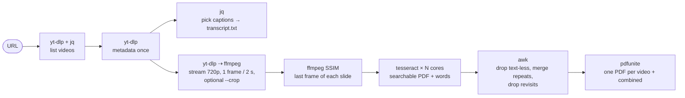

# yt-slides

**Turn YouTube talks and playlists into searchable slide PDFs and transcripts with one bash command.**

> Inspired by [youtube-slide-extractor-ai](https://github.com/vkr1729/youtube-slide-extractor-ai) by Kedarnath Reddy;
> rewritten from scratch as a small bash pipeline over standard tools.

## How it works



1. **List:** `yt-dlp` + `jq` expand the URL into its videos, in playlist order.
2. **Metadata:** `yt-dlp` fetches each video's metadata once, and every later step reuses it.
3. **Transcript:** `jq` picks the best caption track (your `--lang`, else the video's own language) and formats it with timestamps.
4. **Frames:** `yt-dlp` streams the 720p video straight into `ffmpeg`, which samples one frame every 2 seconds (cropped if you pass `--crop`). The video itself is never saved.
5. **Slide changes:** `ffmpeg` compares each frame with the next (SSIM) and keeps the last frame of every slide, so bullet builds are complete.
6. **OCR:** `tesseract` runs on all CPU cores and writes a searchable PDF plus word confidences for each slide.
7. **Filter:** `awk` drops frames without real text, merges neighbours with the same words (ignoring repeated footers), and drops slides shown again later.
8. **Merge:** `pdfunite` joins the slides into one PDF per video and one combined deck.

## Install

```bash
curl -fsSL https://raw.githubusercontent.com/jcxk/yt-slides/main/install.sh | bash
```
This puts the single `yt-slides` script in `~/.local/bin` (set `PREFIX=/usr/local` to change that) and then checks its dependencies.
If something is missing, it prints the exact command for your system, for example:

```text
missing: yt-dlp ffmpeg tesseract pdfunite
install with:
  brew install yt-dlp ffmpeg tesseract poppler        # or: sudo apt install -y yt-dlp ffmpeg tesseract-ocr poppler-utils
```
Run `yt-slides --check` any time to see the same report. From a clone, `make install` does the same thing, and `make uninstall` removes it.
Windows: use WSL.

OCR languages other than English: `brew install tesseract-lang` (all) or `apt install tesseract-ocr-spa` (one),
then pass `--ocr-lang spa` (or `eng+spa`). Check with `tesseract --list-langs`.

## Usage

```bash
yt-slides "https://youtu.be/VIDEO_ID"
yt-slides "https://www.youtube.com/playlist?list=ID" --ocr-lang spa -d ~/slides
yt-slides "https://youtu.be/VIDEO_ID" --crop right=25%          # talk with a webcam on the right
yt-slides "https://youtu.be/VIDEO_ID" --transcript-only --lang es
```

| Option | Description |
|---|---|
| `-o NAME.pdf` | Combined PDF name (default `Combined_Slides.pdf`) |
| `-d DIR` | Output folder (default `./outputs/<timestamp>`) |
| `--lang CODE` | Transcript language (default: the video's original language) |
| `--ocr-lang LANGS` | Tesseract languages, e.g. `eng+spa` (default `eng`) |
| `-j N` | Parallel OCR jobs (default: CPU cores) |
| `--crop SIDES` | Cut edges off every frame, e.g. `right=25%,bottom=10%` (fixed webcam, player bar) |
| `--ssim T` | Slide-change threshold 0–1 (default `0.9`; higher = more slides) |
| `--transcript-only` / `--no-transcript` | Only the transcript / skip it |
| `--check` | Show which required tools are installed |

Output per video: `NN_Title.pdf` and `NN_Title_transcript.txt`, plus `Combined_Slides.pdf` (and `Combined_Transcripts.txt` for playlists).

## Development

```bash
make check                       # bash -n (+ shellcheck if installed)
YT_SLIDES_KEEP=1 yt-slides URL   # keep the temp folder (frames, OCR output) for debugging
```

## Credits
Inspired by [vkr1729/youtube-slide-extractor-ai](https://github.com/vkr1729/youtube-slide-extractor-ai) by Kedarnath Reddy.

## License
[MIT](LICENSE)
