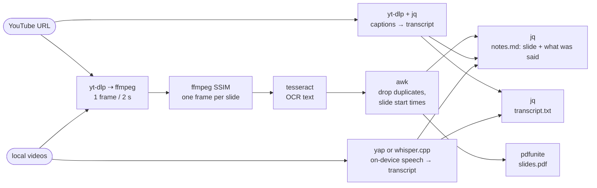

# video2info

[](https://github.com/jcxk/video2info/actions/workflows/test.yml)
[](https://github.com/jcxk/video2info/releases)
[](LICENSE)


Extract the slides and transcript of a video (YouTube, playlists, local files) into **Markdown notes**: each slide with
what was said while it was on screen. Also searchable slide PDFs and plain-text transcripts. One bash script, macOS and Linux.

| | |
|---|---|
| **Category** | Original-slide recovery: keeps the real frames shown in the video, generates nothing |
| **Input** | YouTube videos and playlists (or any [yt-dlp site](https://github.com/yt-dlp/yt-dlp/blob/master/supportedsites.md)), local video files |
| **Output** | `--format md,pdf,txt` (default `md`): Markdown notes with slide images, OCR text and the aligned transcript; searchable slide PDF; timestamped transcript `.txt`. Several videos also get one combined file per format |
| **Processing** | Local. URLs are streamed from the site; frames, OCR and local transcripts run on your machine |
| **Editability** | Markdown text (OCR of each slide + transcript) with the slide images; PDF slides with an OCR text layer; not native PPTX objects |
| **Platforms** | macOS 27 and Ubuntu 26.10 (tested); Windows via WSL not tested |
| **License** | MIT |



A real section of the output for the [CppCon talk](https://www.youtube.com/watch?v=j6UwvOD0n-A) (shortened; OCR text as recognised):

```md
## [00:40] Slide 7


> #include <iostream>
> int main() {
> std::cout << "Hello, World!\n";
> }
> fn main() {
> println!("Hello, world!");

- [00:40] rest so three years ago I was bored um
- [00:45] and I went home and I I've been watching
- [00:47] a lot of CPP cont talks and there was
```

## Performance

No Python runtime and no ML framework. The work is done by long-proven CLI tools (`ffmpeg`, `tesseract`, `yt-dlp`, `jq`, `poppler`), and bash only connects them. Local transcripts run on-device: macOS speech recognition via `yap`, or `whisper.cpp` on Linux.
YouTube videos are streamed at ≤720p straight into `ffmpeg` and never saved to disk, and OCR runs on all CPU cores.

| Video | Length | Result | Time |
|---|---|---|---|
| [CppCon lightning talk](https://www.youtube.com/watch?v=j6UwvOD0n-A) (YouTube) | 2:43 | 11 slides, 46-line transcript | 4.0 s |
| [Clustering explained](https://www.youtube.com/watch?v=A5sfobIi4Ag) (YouTube, Spanish OCR) | 13:27 | 16 slides, 372-line transcript | 6.5 s |
| Local video (`.mp4`, on-device transcript) | 3:09 | 6 slides, 46-line transcript | 4.9 s |

Measured end to end with the default Markdown output (average of 2 runs; YouTube times include streaming the video) on an Apple M6 (12 cores, 24 GB), macOS 27.
On Linux (AMD Ryzen 7 5700X, Ubuntu 26.10) the CppCon talk takes 4.8 s from YouTube; from a local file it takes 3.3 s without a transcript, and 16.2 s with a whisper.cpp transcript, which runs on the CPU.
Times depend on your network and CPU.

## Install

```bash
curl -fsSL https://raw.githubusercontent.com/jcxk/video2info/main/install.sh | bash
```
Installs to `~/.local/bin` (change with `PREFIX=…`) and lists any missing tools with the command to install them.
Pin a release with `… | VIDEO2INFO_REF=v0.3.0 bash`, or download `video2info` from [Releases](https://github.com/jcxk/video2info/releases). Changes: [CHANGELOG](CHANGELOG.md).
Check any time with `video2info --check`.

```bash
brew install yt-dlp jq ffmpeg tesseract poppler yap                                  # macOS (yap: macOS 26+)
sudo apt install -y yt-dlp jq ffmpeg tesseract-ocr poppler-utils whisper.cpp         # Ubuntu / Debian
```
`yap` or `whisper.cpp` is only needed for transcripts of local videos. The first `whisper.cpp` run downloads its
model (~150 MB: `base.en` for English, `base` for other languages) to `~/.cache/video2info`; set
`VIDEO2INFO_WHISPER_MODEL=/path/model.bin` to use another one, or `VIDEO2INFO_STT=whisper` to prefer it on macOS.

## Usage

```bash
video2info "https://youtu.be/VIDEO_ID"                    # YouTube video or playlist → Markdown notes
video2info talk.mp4 -f md,pdf,txt                         # local file, all three formats
video2info ~/Movies/*.mp4 --lang es-ES --ocr-lang spa     # several files → one note each + Combined.md
```

| Option | Description |
|---|---|
| `-f, --format LIST` | `md`, `pdf`, `txt` or a comma list (default `md`) |
| `-d DIR` | Output folder (default `./outputs/<timestamp>`) |
| `-o NAME` | Base name of the combined files for several videos (default `Combined`) |
| `--lang CODE` | Transcript language (YouTube: the video's own; local: `en-US`) |
| `--ocr-lang LANGS` | Tesseract languages, e.g. `eng+spa` (default `eng`; more: `brew install tesseract-lang` / `apt install tesseract-ocr-spa`) |
| `--crop SIDES` | Cut edges off frames, e.g. `right=25%` for a webcam |
| `--ssim T` | Slide-change threshold 0–1 (default `0.9`; higher = more slides) |
| `-j N` | Parallel OCR jobs (default: CPU cores) |
| `--transcript-only` / `--no-transcript` | No slides / no transcript |

Output per video: `NN_Title.md` with `NN_Title_assets/slide-NN.jpg`, `NN_Title.pdf`, `NN_Title.txt` (as chosen with `--format`);
for several videos also `Combined.md` / `.pdf` / `.txt`.

## Development

`make` runs the critical tests: offline, a few seconds, the same ones CI runs on macOS and Ubuntu.

## Credits

Inspired by [youtube-slide-extractor-ai](https://github.com/vkr1729/youtube-slide-extractor-ai) by Kedarnath Reddy.

License: [MIT](LICENSE)
