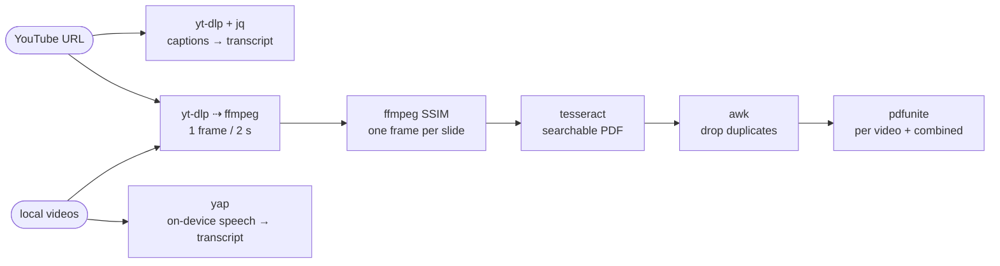

# vid2slides

YouTube talks, playlists or local videos → searchable slide PDFs + timestamped transcripts. One bash script.



## Performance

No Python runtime and no ML framework. The work is done by long-proven CLI tools (`ffmpeg`, `tesseract`, `yt-dlp`, `poppler`), and bash only connects them. Local transcripts use the speech recognition built into macOS.
YouTube videos are streamed at ≤720p straight into `ffmpeg` and never saved to disk, and OCR runs on all CPU cores.

| Video | Length | Result | Time |
|---|---|---|---|
| [CppCon lightning talk](https://www.youtube.com/watch?v=j6UwvOD0n-A) (YouTube) | 2:43 | 11 slides, 46-line transcript | 3.9 s |
| [Clustering explained](https://www.youtube.com/watch?v=A5sfobIi4Ag) (YouTube, Spanish OCR) | 13:27 | 16 slides, 372-line transcript | 6.4 s |
| Local video (`.mp4`, on-device transcript) | 3:09 | 6 slides, 46-line transcript | 4.9 s |

Measured end to end (average of 2 runs; YouTube times include streaming the video) on an Apple M6 (12 cores, 24 GB), macOS 27. Times depend on your network and CPU.

## Install

```bash
curl -fsSL https://raw.githubusercontent.com/jcxk/vid2slides/main/install.sh | bash
```
Installs to `~/.local/bin` (change with `PREFIX=…`) and lists any missing tools with the command to install them.
Needs `yt-dlp jq ffmpeg tesseract poppler`, plus `yap` for local transcripts. Check any time with `vid2slides --check`.

> ⚠️ **macOS only for local transcripts:** they use [`yap`](https://github.com/finnvoor/yap) (`brew install yap`, macOS 26+).
> Elsewhere, add `--no-transcript`. Tested on macOS only.

## Pending

- ⚠️ Local video transcripts on Linux and Windows (WSL): a cross-platform speech-to-text engine in place of `yap`, e.g. [whisper.cpp](https://github.com/ggml-org/whisper.cpp).

## Usage

```bash
vid2slides "https://youtu.be/VIDEO_ID"                    # YouTube video or playlist
vid2slides talk.mp4                                       # local file
vid2slides ~/Movies/*.mp4 --lang es-ES --ocr-lang spa     # several files → one combined deck
```

| Option | Description |
|---|---|
| `-d DIR` | Output folder (default `./outputs/<timestamp>`) |
| `-o NAME.pdf` | Combined PDF name (default `Combined_Slides.pdf`) |
| `--lang CODE` | Transcript language (YouTube: the video's own; local: `en-US`) |
| `--ocr-lang LANGS` | Tesseract languages, e.g. `eng+spa` (default `eng`; more: `brew install tesseract-lang`) |
| `--crop SIDES` | Cut edges off frames, e.g. `right=25%` for a webcam |
| `--ssim T` | Slide-change threshold 0–1 (default `0.9`; higher = more slides) |
| `-j N` | Parallel OCR jobs (default: CPU cores) |
| `--transcript-only` / `--no-transcript` | Only the transcript / skip it |

Output: `NN_Title.pdf` and `NN_Title_transcript.txt` per video, plus `Combined_Slides.pdf` (and `Combined_Transcripts.txt` for several videos).

## Credits

Inspired by [youtube-slide-extractor-ai](https://github.com/vkr1729/youtube-slide-extractor-ai) by Kedarnath Reddy.

License: [MIT](LICENSE)
