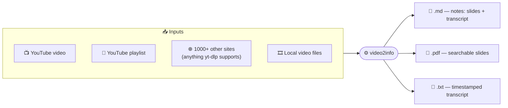
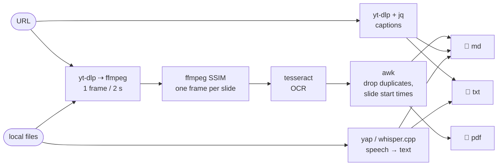

# video2info

[](https://github.com/jcxk/video2info/actions/workflows/test.yml)
[](https://github.com/jcxk/video2info/releases)
[](LICENSE)


**Turn a video into notes.** video2info extracts the slides and the transcript of a talk, and writes Markdown
where each slide sits next to what was said while it was on screen. One bash script, on-device, macOS and Linux.



| 📥 Input | How | 📤 Output | What you get |
|---|---|---|---|
| 📺 YouTube video | `video2info URL` | 📝 **`md`** (default) | One section per slide: time, image, slide text, what was said |
| 📃 Playlist | `video2info PLAYLIST_URL` | 📄 `pdf` | Searchable slide deck (selectable OCR text) |
| 🌐 Other sites | any [yt-dlp site](https://github.com/yt-dlp/yt-dlp/blob/master/supportedsites.md) | 💬 `txt` | Full text + `[mm:ss]` transcript |
| 🎞️ Local files | `video2info *.mp4` (transcribed on-device) | 🗂️ `Combined.*` | One combined file per format, for several videos |

Pick outputs with `-f`: `video2info URL -f md,pdf,txt`.

## 🚀 Quick start

```bash
curl -fsSL https://raw.githubusercontent.com/jcxk/video2info/main/install.sh | bash

video2info "https://youtu.be/VIDEO_ID"                    # → 01_Title.md + 01_Title_assets/
video2info talk.mp4 -f md,pdf,txt                         # local file, all three formats
video2info ~/Movies/*.mp4 --lang es-ES --ocr-lang spa     # several Spanish videos → one note each + Combined.md
```

The installer puts one script in `~/.local/bin` and tells you which tools are missing, with the command to install them:

```bash
brew install yt-dlp jq ffmpeg tesseract poppler yap                            # macOS (yap: macOS 26+)
sudo apt install -y yt-dlp jq ffmpeg tesseract-ocr poppler-utils whisper.cpp   # Ubuntu / Debian
```

> [!NOTE]
> **video2info is a small script (~30 KB) that drives other tools, and you install those yourself.**
>
> | Tool | Used for |
> |---|---|
> | [yt-dlp](https://github.com/yt-dlp/yt-dlp) | list playlists, stream videos, fetch captions |
> | [FFmpeg](https://ffmpeg.org) | decode frames, detect slide changes (SSIM) |
> | [Tesseract](https://github.com/tesseract-ocr/tesseract) | read the slide text (OCR) |
> | [Poppler](https://poppler.freedesktop.org) (`pdfunite`) | join the PDF pages (`--format pdf` only) |
> | [jq](https://jqlang.org) | captions, Markdown and text output |
> | [yap](https://github.com/finnvoor/yap) (macOS) or [whisper.cpp](https://github.com/ggml-org/whisper.cpp) | transcripts of local files (optional) |
>
> **Approximate disk space** (measured: Homebrew package sizes on macOS 27, and the packages apt added on Ubuntu 26.10):
> - **macOS:** ~270 MB for the tools and their Homebrew dependencies, plus `yap` 7 MB. All OCR languages (`tesseract-lang`) add ~650 MB.
> - **Ubuntu 26.10 (server):** ~540 MB for the apt packages above, including whisper.cpp. A desktop install needs less, because many libraries are already there.
> - **whisper.cpp model:** ~150 MB per model (English, or multilingual), downloaded on first use.
> - **Output:** each note's slide images take ~100 KB per slide.

## 📝 What the notes look like

A real section from the [CppCon talk](https://www.youtube.com/watch?v=j6UwvOD0n-A) (shortened, OCR text as recognised):

```md
## [00:40] Slide 7


> #include <iostream>
> int main() {
> std::cout << "Hello, World!\n";
> }
> fn main() {
> println!("Hello, world!");

- [00:40] rest so three years ago I was bored um
- [00:45] and I went home and I I've been watching
- [00:47] a lot of CPP cont talks and there was
```

Slide images are saved next to each note, in `NN_Title_assets/slide-NN.jpg`.

## ⚡ Performance

No Python and no ML framework. The work is done by long-proven CLI tools (`ffmpeg`, `tesseract`, `yt-dlp`, `jq`, `poppler`), and bash only connects them.
Videos are streamed straight into `ffmpeg` and never saved to disk, and OCR runs on all CPU cores.

| Video | Length | Result | Time |
|---|---|---|---|
| [CppCon lightning talk](https://www.youtube.com/watch?v=j6UwvOD0n-A) (YouTube) | 2:43 | 11 slides, 46 transcript lines | 4.0 s |
| [Clustering explained](https://www.youtube.com/watch?v=A5sfobIi4Ag) (YouTube, Spanish OCR) | 13:27 | 16 slides, 372 transcript lines | 6.5 s |
| Local `.mp4`, on-device transcript (yap) | 3:09 | 6 slides, 46 transcript lines | 4.9 s |

Default Markdown output, average of 2 runs, on an Apple M6 (12 cores, 24 GB), macOS 27. On Linux (AMD Ryzen 7 5700X, Ubuntu 26.10)
the CppCon talk takes 4.8 s from YouTube, and 16.2 s from a local file with a whisper.cpp transcript, which runs on the CPU.

## ⚙️ Options

| Option | Description |
|---|---|
| `-f, --format LIST` | `md`, `pdf`, `txt` or a comma list (default `md`) |
| `-d DIR` | Output folder (default `./outputs/<timestamp>`) |
| `-o NAME` | Base name of the combined files (default `Combined`) |
| `--lang CODE` | Transcript language (YouTube: the video's own; local files: `en-US`) |
| `--ocr-lang LANGS` | Slide text languages, e.g. `eng+spa` (default `eng`) |
| `--crop SIDES` | Cut edges off frames, e.g. `right=25%` for a webcam |
| `--ssim T` | Slide-change threshold 0–1 (default `0.9`; higher = more slides) |
| `-j N` | Parallel OCR jobs (default: CPU cores) |
| `--transcript-only` / `--no-transcript` | No slides / no transcript |
| `--check` / `--version` | Show missing tools / print the version |

<details>
<summary>More details: transcripts of local files, OCR languages, pinned installs</summary>

- **Local transcripts** run on-device with [`yap`](https://github.com/finnvoor/yap) (macOS 26+) or [whisper.cpp](https://github.com/ggml-org/whisper.cpp).
  The first whisper.cpp run downloads its model (~150 MB) to `~/.cache/video2info`. Use another model with
  `VIDEO2INFO_WHISPER_MODEL=/path/model.bin`, or prefer whisper on macOS with `VIDEO2INFO_STT=whisper`.
- **OCR languages:** `brew install tesseract-lang` (all) or `sudo apt install tesseract-ocr-spa` (one).
- **Pin a release:** `curl … | VIDEO2INFO_REF=v0.3.0 bash`, or download the script from [Releases](https://github.com/jcxk/video2info/releases). Changes: [CHANGELOG](CHANGELOG.md).
- **Install from a clone:** `make install`; `make uninstall` removes it.

</details>

<details>
<summary>How it works</summary>



</details>

## 📋 At a glance

| | |
|---|---|
| **Category** | Original-slide recovery: keeps the real frames shown in the video, generates nothing |
| **Processing** | Local. URLs are streamed from the site; frames, OCR and local transcripts run on your machine |
| **Editability** | Markdown text with slide images; PDF slides with an OCR text layer; not native PPTX objects |
| **Platforms** | macOS 27 and Ubuntu 26.10 (tested); Windows via WSL not tested |
| **License** | MIT |

## 🛠️ Development

`make` runs the critical tests: offline, a few seconds, the same ones CI runs on macOS and Ubuntu.

## 🙏 Credits

Inspired by [youtube-slide-extractor-ai](https://github.com/vkr1729/youtube-slide-extractor-ai) by Kedarnath Reddy. License: [MIT](LICENSE).
